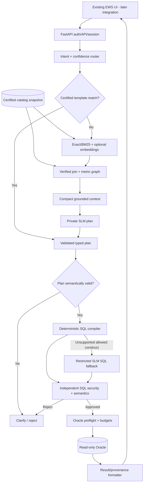
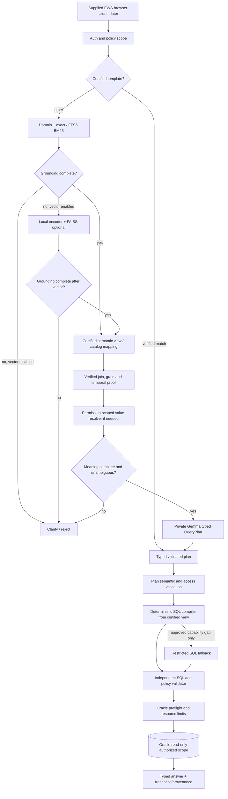

# 03 — System Architecture, Sequence and Trust Boundaries

> **V4.2 FINAL UI DECISION (supersedes earlier UI assumptions):** The user-supplied `index.html`, `script.js`, and `style.css` are the **only UI** for this product. The application deliverable is a backend + adapters + tests. **Do not build React, TypeScript, Vite, new screens, a replacement UI, or a frontend scaffold.** Integrate the existing UI only in a later authorized milestone, without changing its appearance unless the owner separately approves a security or compatibility fix. See [35 Existing UI Integration](./35_EXISTING_UI_INTEGRATION_CONTRACT.md). All non-UI V4.1 NL-to-SQL requirements remain in force.

**Status:** Draft for review; no implementation or company production validation performed.  
**Document owner:** Solution architect  
**Gate:** P0  
**Baseline reference:** V4 research/blueprint supplied on 2026-10-15.  
**Data policy:** Fictional examples only; actual company schema and customer data stay in approved office systems.

> **Core distinction:** this document specifies future behavior. It does not claim that these modules, controls, model benchmarks, or Oracle permissions are already deployed.

## Design specification

## Selected design
A modular FastAPI backend, later integrated with the already-supplied EWS HTML/CSS/JavaScript client; no new frontend project. Request-time components are policy/authentication, session context, route selection, catalog/retrieval/relationship grounding, typed planning, plan checks, deterministic compilation or restricted fallback, independent SQL validation, Oracle executor, formatter and observability. Offline publishing compiles metadata snapshots and indexes. A separately managed SLM inference process is permitted but not mandatory.

## Non-negotiable invariants
1. Authorization is derived from verified identity, not user text or model output.
2. Metadata, model, compiler and validator use the **same catalog version** per request.
3. A database executor accepts only a `ValidatedQuery` capability minted by a trusted validator, never arbitrary user/model SQL.
4. All data values are parameterized; identifier references are allowed only from certified catalog records.
5. No unseen fallback may skip plan or SQL safety checks.
6. Results are attached to the originating authenticated principal and authorization scope.
7. Build-time approval state is separate from runtime model scoring.

## Three paths
- **Fast:** strict certified intent/template, no model call.
- **Normal:** one SLM structured plan, then deterministic compiler.
- **Complex:** supported plan, compiler capability miss, restricted SLM SQL generation, same validation and preflight.
For unsupported metrics, policy denials or missing joins, the fallback is **not** permitted.

## Runtime dependency boundaries
The web browser talks only to API. API can reach catalog, session store and approved internal SLM endpoint. Oracle is reached only through a privileged-restricted execution component. Embeddings never require public network calls. Catalog refresh runs as a separate approved task. Every layer exposes typed requests/results and timeout/error contracts.

## Startup/degradation modes
Application readiness verifies catalog signature/version, auth configuration, query store, allowed Oracle connectivity and model health as appropriate. If model is down, non-model fast path may remain available if explicitly enabled and safe. If catalog authorization information is missing, reject all query execution. If Oracle is unavailable, don't claim answers were retrieved.

## Decision rationale
An embedded graph gives deterministic traversal at small schema sizes. A certified semantic catalog is the authority for business definitions. Vector retrieval is conditional. The compiler is intentionally bounded; unsupported features use restricted fallback. A full distributed agent network adds operational cost without established gains.

## V4.1 target request topology (canonical, replaces simplified earlier sequence if different)

**Invariant:** The fast path still passes plan, SQL and resource gates; arrows in this conceptual diagram omit common checks only for readability. Views are either approved DB views or compiler-level logical views; no implicit new Oracle DDL. Metadata and indexes are compiled offline and pinned to one certified version per request. No graph database or external embedding endpoint is required.
**Trust boundaries:** untrusted user and model inputs cannot define physical joins, permissions, formula SQL, or DB connection details. Every fallback SQL draft gets the same independent validation, and arbitrary SQL validation is not proof of result correctness. See [31](./31_GOVERNED_SEMANTIC_VIEWS_AND_COVERAGE.md) and [33](./33_ORACLE_EARLY_COMPATIBILITY_AND_PREFLIGHT.md).

---

## Deliverables / artifacts to review

Logical/component/deployment diagrams, sequence diagrams, trust-boundary spec, runtime invariants, ADRs

## Acceptance tests and exit criteria

Validate route state machine, failure modes, network egress, consistent catalog version and no fallback bypass

## Open decisions and evidence required

Inference on same host or approved GPU service? Which session store is approved? Existing EWS API compatibility is **required**; approval remains for final auth/session/STT policy.

## Related documents

[01](./01_SCOPE_PRD_AND_NFR.md), [04](./04_SEMANTIC_CATALOG_AND_GOVERNANCE.md), [09](./09_ROUTING_CONFIDENCE_AND_EXECUTION_PATHS.md), [10](./10_QUERY_PLAN_DSL_AND_VALIDATION.md), [11](./11_LOCAL_SLM_MODEL_CONTEXT_AND_RUNTIME.md), [12](./12_DETERMINISTIC_SQL_COMPILER_AND_TEMPLATES.md), [14](./14_SQL_VALIDATION_POLICY_AND_SECURITY.md), [15](./15_ORACLE_ADAPTER_PREFLIGHT_AND_RESOURCES.md), [16](./16_API_AUTH_AND_ERROR_CONTRACTS.md)

---

## Historical V4 Baseline Requirements (reference only; superseded where V4.1 refines them)

> **Historical UI exclusion:** Any older requirement below to create a React/TypeScript/Vite frontend, new browser pages, screens, or UI build/test pipeline is superseded by the user decision. These are historical notes, **not implementation tasks**. Preserve existing capabilities for later integration via document 35.

> This is preserved from the earlier planning draft for comparison. The current V4.1 design section, companion docs 30–34, the approved ADR register, and subsequent validated contracts take precedence on changes explicitly addressed in the V4.1 refinement. Historical descriptions of optional vector providers, open SQL fallback, and late Oracle tests are **not** new mandatory decisions.

The following material records relevant requirements from the previously agreed V4 blueprint. The sections above are the detailed module design and take precedence where they add stricter controls. Original V4 is a **proposed architecture**, not independently verified production source.

# 2. Final System Architecture

## 2.1 Architectural principle

The chatbot will have three main responsibilities:

**Language understanding:** The SLM interprets the user's question.

**Query correctness:** Verified metadata, business definitions, relationship rules and SQL compilation determine how the answer should be obtained.

**Secure execution:** Independent validators and Oracle database permissions determine whether a query may execute.

These responsibilities must remain separate.

## 2.2 High-level system layers

| Layer | Component | Responsibility |
|---|---|---|
| 1 | Existing UI (external supplied asset) | Later integration only; backend guarantees session/chat/result compatibility |
| 2 | API Gateway | Authentication, authorization, validation and request handling |
| 3 | Conversation Manager | Chat history, follow-up context and session ownership |
| 4 | Intent Router | Determine question type and processing route |
| 5 | Semantic Catalog | Store authoritative definitions of business terms |
| 6 | Retrieval Engine | Select relevant business and physical metadata |
| 7 | Relationship Resolver | Find approved table joins and constraints |
| 8 | SLM Service | Translate flexible questions into structured query plans |
| 9 | Query Plan Validator | Verify requested metrics, filters, dates and dimensions |
| 10 | SQL Compiler | Generate SQL deterministically for supported query types |
| 11 | SQL Fallback Generator | Generate constrained SQL for supported complex cases |
| 12 | SQL Validator | Verify syntax, schema, semantics, access and execution policy |
| 13 | Database Executor | Execute authorized read-only Oracle SQL |
| 14 | Result Processor | Format data and produce understandable responses |
| 15 | Observability | Record operational metrics, errors and audit events |

## 2.3 Request processing versus metadata preparation

The system must have two separate workflows.

**Offline metadata preparation**

Approved schema metadata → normalize definitions → verify business relationships → create metadata catalog → build search indexes → publish versioned snapshot.

**Online question processing**

Question → find relevant metadata → create query plan → compile SQL → validate → execute → answer.

This separation is essential for performance.

The system should never rebuild the metadata catalog, embedding index or relationship graph every time someone asks a question.

---

---

# 3. Three Query Execution Paths

The architecture will support three paths.

## Path A — Deterministic fast path

Used when the user asks a question that unambiguously matches an approved query template or certified metric operation.

**Flow:**

User question → exact intent match → validated parameters → approved query template → SQL validation → Oracle → answer.

**Gemma calls:** Zero.

Example:

"Show the latest five reporting periods."

If an approved query template already supports this operation, the system can execute it without invoking the SLM.

### Requirements

- Match only approved templates.
- Extract and validate parameters.
- Confirm required user permissions.
- Verify the current catalog/template version.
- Never confuse a merely similar question with a certified match.
- Route ambiguous wording to the normal path.

This path is intended to minimize latency for frequent queries.

## Path B — Structured SLM planning

This is our default path for flexible business questions.

**Flow:**

Question → semantic retrieval → verified relationships → Gemma generates structured plan → validate plan → SQL compiler → validate SQL → Oracle → answer.

Example:

"Find the top ten customers with the highest exposure last quarter."

Gemma selects an approved metric, grouping, filters, sorting and limit.

The SQL compiler determines the actual Oracle tables, joins, formulas and SQL syntax.

### Benefits

- Less SQL text generated by Gemma.
- Better consistency across repeated queries.
- Easier validation.
- Less dependence on the model knowing Oracle-specific syntax.
- Easier model replacement.
- Clearer debugging when the answer is incorrect.

## Path C — Constrained complex SQL fallback

Some queries require operations outside the deterministic compiler's supported scope.

Examples may include complex analytic windows, unusual correlated subqueries or specialized temporal analysis.

**Flow:**

Question → verified grounding → structured plan → compiler reports unsupported operation → constrained SLM SQL generation → independent validation → Oracle → answer.

### Strict rules

- The model may reference only authorized, approved database objects.
- Required business formulas must come from the semantic catalog.
- The model cannot invent joins or new metric definitions.
- Generated SQL must pass all normal validation.
- Retries must be bounded.
- Unsupported or ambiguous cases must be clarified or rejected.

**Important:** Fallback exists for SQL-expression flexibility, not to bypass governance or missing business definitions.

---
