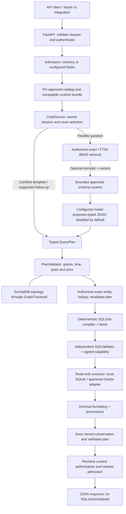
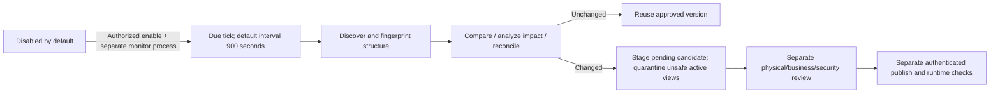

# V4.3 NL-to-SQL: verified system walkthrough

Reviewed against the local source on **24 October 2026**, including the unpublished
SurrealDB migration. This describes the implementation, not a deployed office system.
The user-supplied architecture remains broadly correct; the corrections below matter.
The original numbered design is retained in [DESIGN_REFERENCE.md](DESIGN_REFERENCE.md).

The model proposes a typed plan. Python checks its meaning and permissions, constructs
SQL, independently validates the SQL and permits bounded read-only execution.

## 1. What changed from the supplied architecture

| Supplied description | Verified current implementation |
|---|---|
| NetworkX join graph | Embedded SurrealDB provides runtime join traversal. Pure Python structural graphs remain for deterministic catalog/drift checks. NetworkX is removed from application dependencies. |
| One graph contains all business knowledge | The signed Pydantic catalog remains authoritative. SurrealDB stores a rebuildable projection of certified join topology and lineage; it cannot grant permissions or define a metric. |
| Existing UI sends questions and displays results | The API supports the EWS JSON contract, but the canonical UI remains a frozen reference. It is not served or connected by this backend. |
| Oracle is the running business database | SQLite holds fictional query data locally. Oracle discovery/query adapters exist but live office Oracle is not qualified. The office template selects Oracle, without connecting it here. |
| Generic rate limiting | Memory admission supports single-worker development. Redis implements shared request quotas and active-chat leases for configured concurrent workers. |
| Automatic 15-minute schema monitoring | The interval defaults to 900 seconds. The office launcher explicitly enables and supervises the separate monitor after preparation; bare serve leaves it disabled. |
| Monitor updates the running schema automatically | Scheduled refresh discovers, compares and stages. It never auto-approves or publishes. Signed review and a separate authenticated publication are required. |
| BM25/vector search over schema | Rich schema records have lexical indexing. Optional vectors primarily rank metric documents; there is no claim that every table/column has a vector. |
| Gemma is connected | Model adapters are implemented. Development defaults disabled; the office laptop template selects example private model/tokenizer/embedding endpoints. None is qualified as live. |
| Old flat Python modules | Ownership now follows domain, application, infrastructure, API, bootstrap, CLI and evaluation packages. Use the paths in section 12. |
| 323 tests prove the current build | That number is historical. The migration/audit counts are historical. Use the 24 October architecture-remediation report for the current verification result; see section 13 for earlier evidence. |

## 2. Overall architecture



These are logical components inside a modular Python application, not separate
microservices. Bootstrap owns their construction and cleanup. Redis, office Oracle
and configured model endpoints are external services; SurrealDB and FTS5 are embedded.
The simple standalone demo pins its loaded catalog/resources; the governed runtime
adds publication-aware version replacement and current-grant/drift guards.

## 3. Which database does what?

| Store | Contents and owner | Authority and limits |
|---|---|---|
| Office Oracle | Approved physical dictionary evidence and business query data, through separate adapters/credentials | DBA-owned source of office data. Live privileges, context policies and behavior remain unqualified. |
| Synthetic SQLite business DB | Fictional balances/events, using integer minor units | Development fixtures only; never evidence of corporate Oracle qualification. |
| SQLite metadata repository | Candidates, versioned catalog/grants, signed review evidence, lifecycle, active publication pointer, schedule and audit state | Durable control-plane authority. Protected local storage and trust configuration remain required. |
| SQLite sessions DB | Owner-bound conversations, messages and last validated plans | Durable history. Current authorization is checked; old text cannot confer access. |
| SQLite FTS5 | In-memory, grant-partitioned metric and rich schema text indexes | Rebuildable lexical retrieval evidence, not business data or authorization. |
| SurrealDB | Process-local memory graph rebuilt from a verified immutable local snapshot | Rebuildable topology, not the authority for business definitions or access. |
| Redis, when selected | Expiring request counters and global/per-principal active-chat leases | Admission only. No query-result cache, durable sessions, certified catalog or permission authority. |
| Optional vector snapshots/index | Authorized metadata vectors with versioned encoder identity | Not customer rows. Actual encoder accuracy and office capacity remain open; native SurrealDB projections have local tests. |

SurrealDB therefore replaces the runtime graph engine, not Oracle, Redis or SQLite.
No Neo4j/Milvus service or graph-specific API key is required by this implementation.

## 4. Workflow A: first approved metadata setup

1. **Discover physical structure.** `OracleDiscovery` reads fixed, allowlisted dictionary
   projections using bound owner values. Synthetic/File adapters exercise local contracts.
   This is structure evidence, not sampling customer balances or guessing business meaning.
2. **Normalize and fingerprint.** `PhysicalInventory` records objects, columns, types,
   precision/scale, keys, visibility and definition evidence. Row-value changes do not
   belong in the schema fingerprint.
3. **Reconcile business mappings.** Compare the supplied certified catalog with actual
   physical evidence: object/column existence, types, complete keys, grain and relationships.
   Physical-only discovery can produce a pending candidate but cannot publish a business catalog.
4. **Analyze drift and dependencies.** Identify affected metrics/views and quarantine
   unsafe active mappings. An unrelated report need not be blocked by an independent change.
5. **Build compatible candidate artifacts.** Produce catalog/graph/search fingerprints and
   any explicitly configured vector resources. Record the immutable candidate and issues.
6. **Verify signed review.** Physical, business and security reviewers supply configured
   signature evidence bound to that candidate/source; a separately authenticated administrator
   approves. Neither `approved=true` in JSON nor an LLM response grants authority.
7. **Preflight publication.** Verify signatures, rediscover physical identity, check complete
   runtime resources and rediscover again to detect changes during preparation.
8. **Publish one pointer atomically.** Compare the current publication/revision and activate
   the new version transactionally. A stale candidate must be restaged and reviewed.
9. **Adopt without mixing versions.** Each worker prepares a matching runtime, pins one bundle
   per request and drains retired handles. Current revocation and physical compatibility
   checks still apply to already active requests.

The separate workflow is implemented in
[workflow.py](../backend/nl2sql/application/metadata/workflow.py),
[builder.py](../backend/nl2sql/infrastructure/metadata/builder.py),
[store.py](../backend/nl2sql/infrastructure/metadata/store.py) and
[runtime.py](../backend/nl2sql/bootstrap/runtime.py).

## 5. The certified catalog: meaning before SQL

The catalog declares domains, metrics, dimensions, reporting views, native grains,
approved relationships, scope policies, entity mappings, reporting calendars and units.
For money, the source precision/scale, divisor scale and displayed decimal places are explicit.

For example, a synthetic loan exposure metric can mean `SUM(amount_minor) / 100`,
restricted to the authenticated tenant, allowed regions, active rows and a reporting date.
The same column name in an office table does not establish the same definition.

Adding a table/column that fits supported semantics may need metadata changes and review,
without new Python. A new operation such as an unsupported temporal join still needs a
typed contract, compiler/validator support and independent regression evidence.

## 6. SurrealDB: what the migration actually does

`application/graph.py` defines the `GraphTraversal` boundary and a pure `DirectedGraph`
for structural work. `infrastructure/graph.py` implements the native SurrealDB adapter.
Domain/application modules never import the native driver.

At runtime bootstrap builds/opens `data_dir/graphs/<catalog-digest>.surreal.json`.
A single builder reserves the path, writes/fsyncs a canonical snapshot, verifies it and
renames it atomically. Each worker validates the entire snapshot against its approved
catalog, then populates its own embedded `mem://` database and checks joins/lineage.
This avoids SurrealKV's one-process-per-directory lock while preserving multiple workers
and the separate monitor. Existing version files are never overwritten.

The snapshot has node IDs, a catalog manifest and join/lineage links. Full business
definitions, key pairs, cardinality, temporal rules and reviewer evidence remain in the
catalog and application policy checks; they are not moved into a new graph authority.

`JoinGraph.resolve` filters the view's certified edges, asks the traversal adapter for
allowed paths, tests for alternatives and rejects ambiguity, fanout and incompatible
historical joins. The current path budget is at most six edges. SurrealDB uses bound
SurrealQL parameters and frontier breadth-first traversal rather than enumerating all paths.

Pure Python structural graphs still support catalog/cycle validation and drift dependency
calculations. The SurrealDB adapter can query persisted lineage; this does not mean every
drift calculation is delegated to the native database.

Old graph buffer/DLL configuration has been removed. Per-worker memory stores have
no hard allocator cap; retained bundles and vector partitions multiply memory costs.
Local snapshots are retained after handles drain. Actual office RSS, packaging and
recovery still need qualification; see [migration guide](SURREALDB_MIGRATION.md).

## 7. Retrieval, embeddings and the model

| Component | Implemented behavior | Current qualification |
|---|---|---|
| Exact match | Approved metric names and aliases; exact candidates can return before BM25 | Local synthetic tests |
| FTS5/BM25 | Authorized metric ranking with expansion from the typed column/table/view index | Local synthetic tests |
| Context builder | Candidate-scoped approved metrics/views/dimensions/relationships plus bounded rich records and the QueryPlan schema | Local tests; descriptions remain untrusted data |
| Embeddings | Disabled, synthetic fake, explicitly registered installed local adapter, or approved private HTTP adapter | Real encoder not qualified |
| Vectors | Automatically generated embedded SurrealDB metric-vector projections, exact cosine and reciprocal-rank fusion | Real native synthetic tests; actual encoder accuracy/hardware capacity remain unqualified |
| Model provider | Disabled, scripted, approved private HTTP, or explicitly authorized synthetic-only hosted HTTP | Real Gemma/private inference not qualified |

These layers answer different questions: retrieval finds relevant approved concepts;
the graph checks certified connectivity; the catalog/validator checks business meaning;
the model chooses from the allowed typed vocabulary. Similarity proves neither a safe
join nor permission to query it. Customer transactions are not copied into a vector store.

Gemma and an embedding runtime may be separate approved endpoints. No checkpoint is
downloaded or started by selecting a model name. Restricted office metadata must not be
sent through the synthetic-only hosted mode.

## 8. Workflow B: one complete chat turn

| Step | What actually happens | Owner |
|---|---|---|
| Authenticate | Validate opaque token/JWT, resolve current server-side grants; browser `user_id` is only a consistency check | `infrastructure/auth.py`, `api/app.py` |
| Admit | Check request quota and acquire a global/per-principal active-chat lease when Redis is configured | `infrastructure/rate_limit.py` |
| Pin | Retain one compatible runtime bundle; governed mode refreshes the durable publication and checks identity | `bootstrap/runtime.py` |
| Session | Load an owned, valid state or create one | `application/chat.py`, session port/adapter |
| Route | Recognize supported follow-up, certified exact template, clarification/unsupported input, or flexible model route | `application/chat.py` |
| Retrieve/model, when needed | Find authorized candidates, build bounded context and parse the provider's typed plan; reject ungrounded metric selections | retrieval/context/inference modules |
| Validate meaning | Check approved views, metric/dimension grants, temporal rules, grain, bounded filters and certified graph paths | `application/query/planning.py`, `application/catalog.py` |
| Resolve entities | Convert supported exact identifiers/labels to authorized canonical IDs using separately validated read-only lookups; validate the plan again | `application/chat.py`, `application/query/entity_lookup.py` |
| Compile | Build a deterministic SQLGlot AST, approved physical identifiers and a separate bind contract | `application/query/compiler.py` and specialized query modules |
| Inspect independently | Parse the complete SQL, recheck the semantic proof and verify structure, sources, joins, filters, policy, limits and binds | `application/query/security.py` |
| Issue capability | Sign the query/catalog/principal/bundle identity; expiry is no later than 30 seconds or the request deadline | `SQLValidator` |
| Execute | Verify capability/current guards, use the chosen read-only adapter and enforce row/byte/time budgets | SQLite/Oracle adapters |
| Format/persist | Reverify, compute exact display strings, attach version/reporting provenance and save owner-bound history/last plan | `application/chat.py`, `infrastructure/sessions.py` |
| Authorize response | Governed runtime rechecks current identity; admission must release successfully before a successful API reply | runtime and API admission wrapper |

The two shortcuts bypass retrieval/inference, **not** plan/SQL validation. A disabled
model cannot answer arbitrary flexible questions. Clarification is a safe response,
not a reason to fall back to raw model SQL. SQL/schema/binds are omitted from chat JSON.

Session list/load/delete use `application/sessions.py` directly, not the reporting
pipeline. Ownership and current identity are rechecked; histories redact when the saved
authorization digest differs. Redis admission does not replace these checks.

### Concrete local example

For `Show total loan exposure by region`, the certified synthetic route selects
`loan_exposure` in `loan_snapshot`, grouped by `region`. It uses the approved reporting
date and current tenant/region grants, compiles a bound read-only query and returns exact
money strings. The normal fictional fixture's authorized full-scope example is:

```json
[
  {"region": "Demo North", "loan_exposure": "175000.50"},
  {"region": "Demo South", "loan_exposure": "75000.00"}
]
```

These are fixture expectations, not office data or a live query performed for this document.
Branch names and office metric IDs in the supplied attachment were illustrative; they are
not evidence that a corporate branch catalog is configured.

## 9. Workflow C: schema monitoring without silent publication



`MetadataRefreshService.tick` atomically claims due work under a refresh lease. It
calls `workflow.stage`; it has no call to approve or publish. The foreground runner
does not install a service or create an API-worker scheduler. Retries are bounded.

| Source change | Effect |
|---|---|
| New row or changed balance | No schema rebuild solely for row values; normal queries read the selected data source |
| Added column/table | Inventory evidence and a pending candidate; no new metric or grant automatically |
| Type/key/removal change | Analyze dependencies and quarantine incompatible active reports |
| Changed approved formula/unit/calendar | Reviewed semantic revision and compatible rebuild |
| Revoked metric/region access | Current grants apply again; old requests/history cannot restore access |
| No structural/semantic change | Reuse compatible resources instead of re-embedding/rebuilding unnecessarily |

## 10. Financial accuracy, caching and resource lifecycle

Synthetic money is stored as integer minor units. Oracle NUMBER precision/scale must
be declared, bound and normalized through the approved driver contract. Exact averages
use sum/count and Decimal; approved ratios and display scale use explicit precision.
Money outputs are strings. A correct SQL shape alone does not certify a business formula.

The typed compiler supports selected approved sums/counts/min/max, averages, differences,
ratios, grouped filters, date/fiscal bounds, composite joins, preaggregation CTEs and
ROW_NUMBER/DENSE_RANK patterns. General SCD2 joins, unrestricted SQL/windows/formulas,
period-over-period operators and average/ratio sorting or HAVING remain unsupported.

Search resources and encoder results are bounded and versioned. Their identity includes
catalog/grants and, when used, model/version/dimension/normalization. Metadata caches are
not an unrestricted cache of customer answers. A failed new build preserves active resources.

Requests retain one bundle lease. Old graph/database/index handles drain before closure.
Current-grant changes and incompatible physical drift can still reject a pinned request.
Rollback requires compatible physical state and current policy/grants; it cannot resurrect
revoked access. This is graceful version replacement, not proof of production zero downtime.

## 11. Deployment: local development versus the intended VM

| Concern | Local synthetic profile | Intended office VM configuration |
|---|---|---|
| API workers | One; memory admission | Laptop profile selects eight overall chats/one inference; concurrent VM profile selects Redis/two workers; capacity remains unqualified |
| Business queries | Fictional SQLite | Approved read-only Oracle credentials and DBA context policies |
| Graph/search | Embedded SurrealDB and FTS5 | Same logical adapters with approved local storage/native packaging |
| Sessions/metadata | Separate local SQLite stores | Shared approved local VM paths; network shares/multi-node HA unqualified |
| LLM/embeddings | Disabled or scripted/fake tests | Approved private endpoints or registered installed runtime, then evaluation |
| UI/ingress | Frozen reference; loopback API | UI integration, proxy/TLS and corporate identity are office work, not deployed here |
| Monitor | Disabled | Explicitly approved separate process/service owner; no auto-publication |

Redis quotas span workers, but per-worker Oracle pools, FTS indexes and native graph
buffers still consume resources. Multiple workers multiply those budgets. Lua leases
expire after crashes; they do not forcibly interrupt a hung native driver/model or provide
strict physical fencing during Redis loss. Redis Cluster/Sentinel and multi-node operation
are not implied by a standalone Redis connection.

Runtime profiles, inventories, approvals, snapshots, graph files and sessions belong in
marked restricted storage with approved ACLs outside OneDrive/sync and network shares.
Git ignores and `.metadata-private` markers are exclusion signals, not access controls.

## 12. Current source ownership map

| Area | Actual paths under `backend/nl2sql/` |
|---|---|
| HTTP transport and EWS compatibility | `api/app.py`, `api/schemas.py`, `api/middleware.py`, `api/compatibility.py` |
| Domain contracts | `domain/models.py`, `domain/physical.py`, `domain/metadata.py`, `domain/governance.py`, `domain/search.py`, `domain/sessions.py` |
| Chat, context, session use cases | `application/chat.py`, `application/context.py`, `application/sessions.py`, `application/ports.py` |
| Catalog/join rules and traversal port | `application/catalog.py`, `application/graph.py` |
| Query semantics and SQL | `application/query/planning.py`, `compiler.py`, `security.py`, `composite.py`, `ranking.py`, `entity_lookup.py`, `physical_sql.py`, `sql_types.py` |
| Metadata certification/workflow | `application/metadata/certification.py`, `drift.py`, `workflow.py`, `refresh.py`, `ports.py` |
| Native graph | `infrastructure/graph.py` |
| Identity, sessions and admission | `infrastructure/auth.py`, `infrastructure/sessions.py`, `infrastructure/rate_limit.py` |
| Query adapters | `infrastructure/databases/sqlite.py`, `oracle.py`, `oracle_factory.py` |
| Metadata adapters and authority | `infrastructure/metadata/oracle_discovery.py`, `discovery.py`, `store.py`, `governance.py`, `catalog_store.py`, `builder.py`, `config.py` |
| Retrieval/embedding/vector adapters | `infrastructure/retrieval/lexical.py`, `embeddings.py`, `embedding_cache.py`, `vector_index.py` |
| Model providers | `infrastructure/inference/model.py` |
| Composition and cleanup | `bootstrap/factory.py`, `resources.py`, `managed.py`, `runtime.py` |
| Commands/config/evaluation | `cli/main.py`, `cli/metadata.py`, `settings.py`, `evaluation/` |

Dependency direction is documented and tested in [STRUCTURE.md](STRUCTURE.md): domain
contracts point inward, application depends on contracts/ports, infrastructure implements
ports, transport delegates and bootstrap wires concrete resources. There are no legacy
flat-module forwarding layers to preserve obsolete filenames from the attachment.

## 13. Built, tested and still pending

| Capability | Status supported by current evidence |
|---|---|
| API/contracts, scope-aware plans, deterministic SQL and independent signed execution | Implemented; local synthetic security/compiler/API tests |
| Embedded SurrealDB, native lifecycle and immutable projections | Implemented and exercised locally on Windows; office packaging/load/recovery unqualified |
| Metadata discovery/reconciliation/signatures/publication/pinning/drift/rollback | Implemented locally; no corporate schema or business catalog certified |
| Redis quotas and active leases | Implemented; prior explicit real local Redis suites exist; VM Redis connectivity/capacity still requires qualification |
| Durable sessions and response-time access checks | Implemented locally; enterprise retention/backups/IAM remain office responsibilities |
| LLM, encoder and Oracle adapters | Adapter/contract support exists; fakes do not qualify the real integrations |
| EWS frontend reference | Preserved byte-for-byte; browser integration remains outside implemented scope |
| Production hosting and real banking answer accuracy | Not established by synthetic tests or configuration examples |

The existing [graph migration report](../reports/graph-migration-2026-10-23.md) records
399 passing tests, eight Redis tests skipped, 89% coverage and all mandatory quality gates.
A fresh `python scripts/check.py` audit on 23 October 2026 also completed 399 tests,
eight Redis skips and one upstream warning in 575.42 seconds, with 89% coverage.
The raw local log is `.local/architecture-audit-quality-20261023.txt`. Redis tests require
an explicitly selected local test URL and were not run; no office provider was contacted.
The direct lint/format, Pylint and Pyright gates passed. The original final pre-commit gate
reported a file-change detection while this review was editing documentation, despite zero
Pyright errors; the stable follow-up rerun passed all three hooks. The initial combined
command therefore exited 1; this is not reported as an uninterrupted exit-0 quality run.
No checks were weakened and no application code was changed for this review.

## 14. How we proceed from here

1. Preserve the layer boundaries, typed planning, signed query capabilities and semantic
   approval rules while finishing native packaging and resource budgets on the intended VM.
2. Provision approved restricted storage, real corporate identity/revocation, Redis and
   DBA-owned discovery/query identities and context set/reset procedures.
3. Discover an approved synthetic Oracle environment, map steward-owned metric definitions,
   units, grains, calendars and logical joins, obtain signatures and publish a compatible bundle.
4. Configure an approved real model/encoder only when needed; run business-owned held-out
   answer/rejection goldens and representative HTTP concurrency/latency/memory tests.
5. Agree monitoring, schema freshness, retention, backups, rollback and operational ownership.
   Enable the separate monitor only after approval. Plan UI/ingress integration separately.

These are next integration steps, not actions performed or authorized by this explanation.
New components are justified by measured requirements; SurrealDB does not require replacing
working semantic, storage, authentication or SQL safety boundaries.

## 15. Maintained reference for future work

Use this walkthrough for the user-facing system explanation, [ARCHITECTURE.md](ARCHITECTURE.md)
for detailed contracts/limits, [STRUCTURE.md](STRUCTURE.md) for source ownership,
[CONFIGURATION.md](CONFIGURATION.md) for settings and [OPERATIONS.md](OPERATIONS.md) for procedures.
Keep them synchronized when code changes. Dated exports/diagrams and original design text
are historical evidence; inspect current code before treating them as implementation truth.

## Office automation update

`office` now prepares derived metadata and supervises separate API/monitor children. Use
OPERATIONS.md for the command and signed first-publication flow. FAISS/factory adapters
are removed; configured embeddings populate embedded SurrealDB vector projections. You do
not build graph/vector projections by hand. Typed schema search grounds live questions.
Restricted inference preflights the entire chat body with the selected runtime tokenizer
and output reserve. The six-edge execution ceiling now matches planning. Explicit private
environment files reach Oracle/trust settings as well as the application. None of this
qualifies a real model, corporate Oracle or the target Mac.


## Architecture remediation on 24 October 2026

The current implementation additionally supports typed model clarification, an owned pending
question, and general SLM follow-up context from the previous validated plan. Every reuse is
checked against current catalog/grants; previous messages and result rows do not grant access.
Default structured inference uses PlanningDecision containing a QueryPlan or typed clarification.
Direct QueryPlan adapter replies remain accepted for compatibility. Clarification never executes SQL.

The office example now starts without embeddings or persistent vector snapshots. Enabling an
approved private encoder still generates SurrealDB vectors automatically during governed preparation.
All authorized metric/schema text is preflighted, and native vector buffers have an explicit
per-retriever ceiling. Embedding checkpoints are metadata-only preparation work, not query writes.

Versioned SQLite upgrades retain legacy data, payload identities and timestamps. Unknown future
formats reject safely. Application deadlines cover authentication/adoption waits and nested chat
cannot reset them. Both API chat contracts share admission and pipeline failure/success metrics.
Office startup requires patched native SQLite and protected absolute paths outside source/sync
folders. The real Oracle/SLM/identity and target machine remain unqualified; see the dated
architecture-remediation report rather than treating older test counts as the current release result.

The subsequent office-qualification changes target 100000 tokens in both office examples.
Overall chat admission still covers the complete turn. A second, separately scoped model
lease limits inference to one call initially, shared across catalog replacements and Redis
workers when configured. Templates and recognized follow-ups skip the model lease; ordinary
database/session and per-user protections remain. Outer saturation may still reject templates.
Context size and hardware/SLM accuracy are configuration targets requiring actual measurement.
