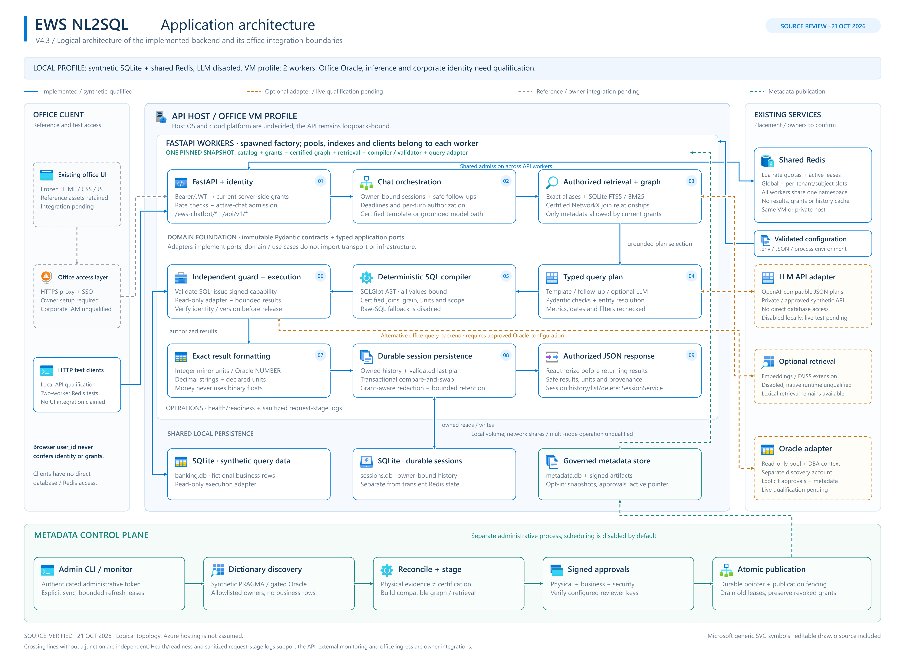

# Current system diagrams — 23 October 2026

These diagrams describe the current local working source, including the unpublished
LadybugDB migration. They are logical architecture/process views, not deployment claims.
The complete comparison with the older supplied architecture is in
[System walkthrough](APP_WALKTHROUGH.md).

- [Current system and storage roles](../.archify/architecture-system-review-20261023-174500/system-overview.html).
- [Inside one chat request](../.archify/architecture-system-review-20261023-174500/chat-request.html).
- [Metadata setup, signed publication and optional monitoring](../.archify/architecture-system-review-20261023-174500/metadata-publication.html).

These HTML files are local generated artifacts under `.archify/`; copy that folder with
this source tree if sharing the local diagram links. The source-readable Mermaid diagrams
in APP_WALKTHROUGH.md remain available independently.

## Historical image formats

The earlier SVG/PNG/draw.io images below predate the graph migration and retain their
original dated content. Use the current links above for LadybugDB and current behavior.

> Graph migration note (2026-10-23): the dated diagram shows the previous graph engine. Current runtime uses embedded LadybugDB; see ARCHITECTURE.md and reports/graph-migration-2026-10-23.md. UI reference assets remain unchanged.

# Application architecture diagram

Source review: **21 October 2026**. This is one logical architecture diagram,
provided in three formats. It describes implemented code and explicitly marks
office integrations that still need approval and live qualification. Azure-style
notation does not mean the application is deployed on Azure.

- [SVG: scalable diagram](diagrams/application-architecture.svg).
- [PNG: high-resolution image](diagrams/application-architecture.png).
- [draw.io: editable source](diagrams/application-architecture.drawio). Open it in
  an approved diagrams.net/draw.io installation. Component cards, labels, icons
  and connectors are editable; the source is not a flattened screenshot.

## How to read the diagram

The numbered request path runs left to right across the first row, right to left
across the second, then left to right across the third. It is a logical sequence
within a modular monolith, not nine independently deployed services. Certified
templates and deterministic follow-ups can bypass model inference and retrieval;
entity resolution can issue separately authorized read-only lookups before final
compilation. Session list/load/delete use `SessionService` directly rather than
running the reporting pipeline. JSON responses return through the inbound API
connection; the diagram does not draw a second return line across every node.

| Notation | Meaning |
|---|---|
| Blue solid cards and arrows | Implemented code and locally exercised synthetic paths; not a production deployment claim |
| Amber dashed cards and arrows | Optional provider/office adapter; actual external service qualification remains pending |
| Gray dashed cards and arrows | Frozen reference assets or office-owned ingress/identity integration that is not implemented here |
| Teal cards and publication arrows | Separate metadata control plane and governed runtime publication |
| Crossing lines without a junction | Independent connections, not data exchange at the crossing |

## Important boundaries

- **Current local profile:** fictional SQLite query data, durable SQLite sessions
  and shared Redis admission. Inference and embeddings remain disabled. The
  development example also supports a single-worker memory limiter; the VM
  example requires Redis and provisionally selects two API workers.
- **Configuration inputs:** the worker factory loads validated JSON settings,
  one explicitly selected application dotenv and process-environment overrides.
  Secrets can be injected by the approved launcher; no particular secret-manager
  service is provisioned. Oracle account settings use separate process-environment
  loaders and do not read the application's dotenv file.
- **Client and identity:** the retained office UI is unchanged and is not hosted
  by FastAPI. Corporate SSO, HTTPS ingress and browser integration remain owner
  work. Implemented authentication accepts configured bearer-token hashes or
  locally configured HS256 JWTs and resolves server-side principals. It does not
  establish corporate identity integration. Browser `user_id` never grants rights.
- **Redis:** shared rolling-minute quotas and active-chat leases, with bounded
  connections and timeouts. Redis is not the chat-history, SQL-result, grant or
  metadata-authority cache. Redis failure safely blocks protected work; readiness
  probes its required commands. Its final placement may be the same VM or an
  approved private host.
- **Three persistence responsibilities:** `banking.db` holds fictional query
  data; `sessions.db` holds owned conversations; governed `metadata.db` and its
  restricted artifacts hold candidates, approvals and the active publication.
  These are distinct stores. FTS5 partitions are per-worker in-memory SQLite
  indexes, not another deployed database server. Governed metadata is opt-in;
  the basic synthetic path pins the checked catalog directly.
- **Model boundary:** the HTTP model adapter sends authorized metadata context
  to a configured OpenAI-compatible endpoint and accepts typed plans, not SQL or
  permissions. Private inference needs an approved host and TLS; public hosted
  inference is restricted to explicitly authorized synthetic data. No provider
  or specific model has been live-qualified by this drawing.
- **Query boundary:** compilation binds values and uses certified metadata. An
  independent SQL validator issues a short-lived signed capability before the
  read-only adapter executes. The Oracle adapter is an alternative query backend
  to synthetic SQLite, not a replication or caching connection between them.
  Oracle needs a governed metadata root, a separately approved query identity,
  verified read-only grants and DBA context apply/reset routines. Discovery uses
  a separate allowlisted dictionary identity. No company Oracle was contacted.
- **Metadata control plane:** explicit CLI/monitor operations discover evidence,
  reconcile and stage compatible resources, verify configured physical/business/
  security signatures and atomically publish a durable version. Discovery alone
  does not certify semantics or access. Requests pin one compatible snapshot;
  old leases drain and revoked grants must not be restored by rollback.
  Scheduling defaults off and never runs inside API workers.
- **Operations:** health/readiness endpoints and sanitized request/stage logs
  are implemented. Office monitoring, restricted-storage ACLs, backup/retention,
  ingress, service management and measured VM capacity remain qualification work.
  There is no claimed Azure Key Vault, Azure SQL, Azure OpenAI, Application
  Gateway, Kubernetes cluster, vector database or multi-node deployment.
- **Product limits:** reporting uses synchronous JSON. Speech transcription
  currently returns an authenticated 501. Export, result-pagination and background
  cancellation jobs are not implemented product surfaces and are not depicted as
  working services. The diagram's standalone files are offline-viewable; the
  application itself is not established as fully offline (the frozen UI references
  public CDNs and approved external providers may be configured).

## Source traceability

| Diagram component | Owning source |
|---|---|
| API routes, authentication dependency, admission, health | `backend/nl2sql/api/app.py`, `api/middleware.py` |
| Worker composition and pinned runtime bundles | `backend/nl2sql/bootstrap/factory.py`, `resources.py`, `managed.py`, `runtime.py` |
| Chat orchestration and deterministic routing | `backend/nl2sql/application/chat.py`, `context.py` |
| Current identity and owned-session operations | `backend/nl2sql/infrastructure/auth.py`, `application/sessions.py` |
| Immutable domain contracts and typed ports | `backend/nl2sql/domain/`, `application/ports.py` |
| Exact/BM25 retrieval and certified graph | `backend/nl2sql/infrastructure/retrieval/lexical.py`, `application/catalog.py` |
| Typed plans, compilation, capability validation | `backend/nl2sql/application/query/planning.py`, `compiler.py`, `security.py` |
| Shared quotas and active leases | `backend/nl2sql/infrastructure/rate_limit.py` |
| Durable session and query adapters | `backend/nl2sql/infrastructure/sessions.py`, `databases/sqlite.py`, `oracle.py`, `oracle_factory.py` |
| Optional inference, embeddings and native vector adapters | `backend/nl2sql/infrastructure/inference/model.py`, `retrieval/embeddings.py`, `embedding_cache.py`, `vector_index.py` |
| Discovery, certification and publication | `backend/nl2sql/application/metadata/`, `infrastructure/metadata/`, `cli/metadata.py` |
| Runtime configuration | `.env.example`, `config/vm.env.example`, `config/office.example.json`, `backend/nl2sql/settings.py` |
| Qualification and evaluation | `tests/{unit,contracts,integration,security,evaluation,tooling}/`, `scripts/check.py`, benchmark scripts |

Read [Current architecture](ARCHITECTURE.md), [Code structure](STRUCTURE.md),
[Configuration](CONFIGURATION.md) and [Operations](OPERATIONS.md) for implementation
limits and operating requirements. Original decisions remain in numbered sections
22 and 28 of [Design reference](DESIGN_REFERENCE.md).

## Symbols and maintenance

The diagram embeds **18 generic symbols** from Microsoft's official
[Azure architecture icon collection](https://learn.microsoft.com/en-us/azure/architecture/icons/),
package `Azure_Public_Service_Icons_V24.zip`, downloaded on 21 October 2026.
Only the generic Browser, Code, Workflow, Search, Module, Gear, Toolbox, Table,
Files, Input-Output, Globe-Warning, Dev-Console, Cache, Search-Grid, SSD, Powershell,
Versions and Server-Farm symbols are used. Icons retain their original proportions,
shapes and colors. Product-specific Azure service icons are not used to relabel
the application's SQLite, Redis, LLM or Oracle adapters. Microsoft retains rights
to its icons; this use is architectural documentation under the linked terms.
The full downloaded icon collection is not included in the source repository.

Maintain the editable `.drawio` file, then export updated SVG and PNG copies at
the same paths. Keep all three formats consistent with the code and status legend.
The SVG and PNG are self-contained and require no CDN or network access to view.
Application dependencies, UI files and runtime configuration are unchanged.
